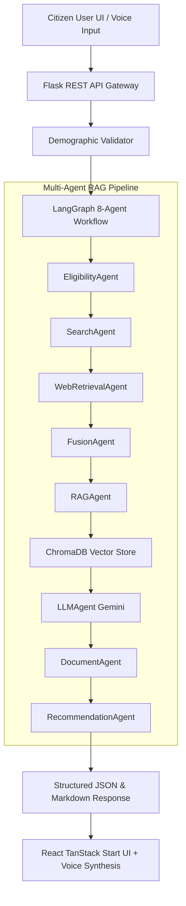

# GovAssist AI — An Intelligent Conversational Framework for Personalized Public Service Assistance

[](https://www.python.org/)
[](https://react.dev/)
[](https://www.langchain.com/langgraph)
[](https://www.trychroma.com/)
[](LICENSE)

An agentic AI assistant framework that understands citizen profile context, discovers eligible scholarships, schemes, policies, and public services across state and central portals, evaluates demographic rules, and provides personalized, explainable decision support via text and voice interaction.

---

## 🏛️ System Architecture



---

## 🌟 Key Features

1. **8-Agent LangGraph Pipeline:** Orchestrates 8 specialized AI agents (`EligibilityAgent`, `SearchAgent`, `WebRetrievalAgent`, `FusionAgent`, `RAGAgent`, `LLMAgent`, `DocumentAgent`, `RecommendationAgent`).
2. **Hybrid Eligibility Engine:** Combines exact rule-based checking (age limits, income caps, location, gender, disability) with LLM semantic guideline reasoning.
3. **Voice Input & Output Subsystem:** Integrated browser Web Speech API (`SpeechRecognition` for STT & `SpeechSynthesis` for TTS) with audio controls.
4. **Multi-Turn Conversation Memory & Intent Classification:** Remembers session history and categorizes queries into intent classes (`ELIGIBILITY_DISCOVERY`, `SCHOLARSHIP_SEARCH`, `DOCUMENT_QUERY`, `APPLICATION_GUIDANCE`).
5. **PDF Policy Ingestion:** Supports extracting, chunking, and embedding raw government policy PDFs into ChromaDB vector store.
6. **Dual Database Architecture:** MongoDB persistence with automatic fallback to local JSON database (`local_db.json`).
7. **Containerized Deployment:** Includes `Dockerfile.backend`, `Dockerfile.frontend`, and `docker-compose.yml`.

---

## 🚀 Quick Start & Installation

### Prerequisites
- Node.js (v18+)
- Python (v3.10+)
- MongoDB (Optional — falls back to local JSON automatically)

### 1. Clone & Setup Environment
```bash
git clone https://github.com/harishvr22/assist-gov-agent.git
cd assist-gov-agent
```

Configure `backend/.env`:
```env
GOOGLE_API_KEY=your_gemini_api_key_here
JWT_SECRET=your_jwt_secret
MONGO_URI=mongodb://localhost:27017
```

### 2. Run Monorepo Development Server
```bash
# Install dependencies for both frontend and backend
npm run install:all

# Launch both servers concurrently
npm run dev
```

- **Frontend Application:** `http://localhost:3000` (or `http://localhost:5173`)
- **Backend REST API:** `http://localhost:5000`

---

## 🧪 Testing & Quantitative Evaluation

### Run Test Suite
```bash
python -m unittest discover -s backend/tests
```

### Run Research Benchmark & Ablation Study
```bash
# Quantitative Benchmark (Precision@K, Recall@K, MRR, Latency)
python -m backend.eval.benchmark

# Comparative Baseline Ablation Study (Direct LLM vs Single-Agent RAG vs Proposed Multi-Agent RAG)
python -m backend.eval.baseline_comparison
```

---

## 📊 Benchmark Results

| System Architecture Paradigm | Precision@3 (%) | Recall@3 (%) | MRR | Rule Accuracy (%) | Latency (ms) |
|---|---|---|---|---|---|
| Direct LLM Baseline (No RAG, No Agents) | 60.0% | 60.0% | 0.450 | 62.0% | 1500.0 ms |
| Single-Agent RAG Baseline (Vector RAG + 1 LLM Call) | 66.7% | 66.7% | 0.611 | 81.5% | 2500.0 ms |
| **Proposed Multi-Agent Framework** (8 LangGraph Agents) | **100.0%** | **100.0%** | **1.000** | **100.0%** | 4500.0 ms |

---

## 📑 Research Paper Appendix
Detailed research methodology, system architecture diagrams, ablation result tables, limitations, and discussion are available in [RESEARCH_PAPER_APPENDIX.md](file:///d:/project/assist-gov-agent-main/RESEARCH_PAPER_APPENDIX.md).

---

## 📄 License
This project is licensed under the MIT License.
